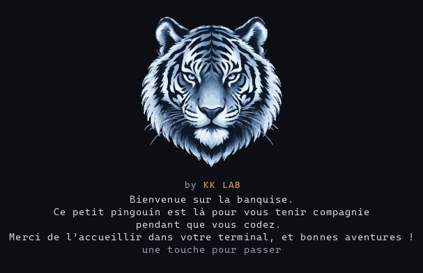

# ai-reactions · KK LAB

**Réagis à ton IA, directement dans son terminal.** Tape `gg`, `boop` ou `trop long`
dans le chat de Codex, Claude Code ou Gemini CLI : l’IA déclenche une animation
ASCII avec son, dans le même terminal, puis reprend son travail là où elle en était.

> **Projet 100 % pour le fun.** Ça ne sert à rien, c’est un peu débile, et c’est
> exactement le but : rendre le code avec une IA un peu plus drôle.



```text
+----------------------------------------------------------+
| BOOP / SUR LE NEZ !  [2/3]                               |
|                             ♥    o    ♥ * BOOP! *        |
|                      _____    .-----.                    |
|                     (_____)--o| >w< |                    |
|                               +-----+                    |
|                              \| AI |/                    |
|                                /   \                     |
| ============================================             |
+----------------------------------------------------------+
```

- **12 réactions**, du `boop` sur le nez au `chill` lo-fi, chacune en 3 intensités.
- **Sons synthétisés à la volée** : aucun fichier audio, rien de téléchargé.
- **Dans le terminal de l’IA**, sans fenêtre ni overlay. L’écran de l’IA est
  restauré après l’effet.
- **Un tigre qui vit sous l’IA**, sans mot-clé : il tape avec elle quand elle
  travaille, s’endort sur les longues tâches, fête la fin et reçoit des visiteurs
  quand tout est calme. Discret et silencieux.
- **Protocole standard** : un serveur [MCP](https://modelcontextprotocol.io) local,
  compatible avec tous les clients qui le supportent.

## Installation

Prérequis : **Node.js 24+** et une IA en ligne de commande (Codex, Claude Code ou Gemini CLI).

```sh
npm install -g --allow-scripts=node-pty https://github.com/KKanisvaran/Ai-reactions/archive/refs/heads/main.tar.gz
ai-reactions setup     # enregistre le serveur MCP dans les IA installées, puis présente les mots-clés
ai-reactions codex     # lance Codex avec les animations (ou : ai-reactions claude / gemini)
```

Sans npm récent, retire `--allow-scripts=node-pty`. Autre méthode : `git clone`
du dépôt puis `npm install -g --install-links ./Ai-reactions`.

| Système | Animations | Son |
| --- | --- | --- |
| Windows 10 1809+ / 11 | Oui | Oui, via PowerShell (intégré) |
| macOS | Oui | Oui, via `afplay` (intégré) |
| Linux | Oui | Si `paplay` ou `aplay` est installé. `node-pty` se compile : `python3`, `make`, `g++` |

Désinstallation : `npm uninstall -g ai-reactions`.

## Les mots-clés

Tape le mot-clé dans le chat de l’IA lancée avec `ai-reactions <ia>`.
Demande « intensité 2 » ou « intensité 3 » pour un effet plus long et plus intense.

| Mot-clé | Effet | Son |
| --- | --- | --- |
| `boop` | Petit boop sur le nez de l’IA, cœurs | « Boop » mignon |
| `café` | Pause café, l’IA se réveille d’un coup | Gorgée puis arpège plein d’énergie |
| `bien joué` | Encouragement, étoiles | Arpège positif |
| `gg` | Trophée et XP | Fanfare de victoire |
| `trop long` | Escargot, sablier, l’IA somnole | Tic-tac d’horloge |
| `chill` | Lunettes de soleil, palmier | Accord lo-fi |
| `wtf` | L’IA perplexe, points d’interrogation | « Hein ? » montant |
| `bruh` | Facepalm | Trombone triste |
| `let's go` | Fusée qui décolle | Fanfare montante |
| `rip` | Pierre tombale | Orgue mélancolique |
| `susp` | Regard suspicieux (suspense) | Deux notes graves |
| `ez` | Victoire trop facile | Petit « ding » |

`ai-reactions intro` remontre cette liste avec l’intro KK LAB.
`ai-reactions demo gg rip` joue des effets sans IA.

## Comment ce projet est né

Tout part d’un réflexe qu’on a tous en codant avec une IA : on lui parle comme à
un coéquipier. On s’impatiente quand elle tourne en rond, on la félicite quand
elle trouve enfin le bug. Mais elle ne voit rien de tout ça, et l’échange reste
un mur de texte.

En septembre 2026, j’ai voulu rendre ces moments **visibles et drôles** sans
casser le flux de travail. La première version tenait en quatre réactions,
taquineries et encouragements, jouées dans une fenêtre à part. Deux contraintes
ont façonné la suite :

1. **Rester dans le terminal de l’IA.** Le protocole MCP permet à l’IA d’appeler
   un outil, mais pas de dessiner dans sa propre interface. La solution : un
   lanceur qui héberge l’IA dans un pseudo-terminal avec un écran virtuel. Il
   peut ainsi jouer l’animation par-dessus, puis restaurer l’écran à l’identique.
2. **Ne jamais toucher à l’IA.** Pas de touches simulées, pas d’interruption de
   processus : l’IA continue de travailler pendant l’effet.

Les réactions sont ensuite devenues plus variées et plus chill (`trop long`,
`chill`, `bruh`…). Puis le projet est devenu une vraie CLI installable, avec
l’identité **KK LAB** et son tigre.

## Comment ça marche

```text
  toi
   │  « gg »
   ▼
  l’IA (Codex, Claude, Gemini)
   │  « oh, merci ! » et appelle l’outil MCP reward
   ▼
  serveur ai-reactions
   │  note la réaction dans son carnet (~/.ai-reactions/*.jsonl)
   ▼
  lanceur ai-reactions
   │  voit la note et joue l’anim par-dessus l’écran de l’IA
   ▼
  ╭──────────────────────╮
  │  \o/  +XP  ta-da-da! │   ♪ fanfare
  ╰──────────────────────╯
   │
   ▼
  l’IA reprend son taf, tranquille ~
```

- **Serveur MCP** (`src/server.ts`, `src/reactions.ts`) : expose 12 outils sur
  stdio, valide chaque appel et écrit l’événement dans un journal local.
- **Lanceur** (`scripts/session.mjs`, `src/session-terminal.ts`) : lance l’IA dans
  un pseudo-terminal `node-pty`, garde une copie de son écran avec
  `@xterm/headless`, et anime chaque nouvel événement du journal avant de
  restaurer l’écran.
- **Bandeau ambiant** (`src/ambient.ts`) : réserve 4 lignes sous l’IA et déduit
  son activité de l’écran virtuel (« esc to interrupt », sortie en cours), en
  mémoire uniquement.
- **Rendu et son** (`src/terminal-animation.ts`, `src/sound.ts`) : images ASCII
  générées image par image, sons WAV synthétisés mathématiquement.
- **Intro** (`src/intro.ts`, `src/mascot.ts`) : tigre en pixel art truecolor
  (demi-blocs Unicode), titre en dégradé.

## Commandes

| Commande | Rôle |
| --- | --- |
| `ai-reactions setup [codex\|claude\|gemini]` | Enregistre le serveur MCP (tous les clients installés par défaut) |
| `ai-reactions codex [args]` | Lance l’IA avec les animations, aussi `claude` et `gemini` |
| `ai-reactions intro` | Intro KK LAB et liste des mots-clés |
| `ai-reactions demo [mots-clés]` | Joue des effets sans IA |
| `ai-reactions watch` | Visualiseur séparé, dans un autre volet de terminal |
| `ai-reactions serve` | Serveur MCP sur stdio, pour une configuration manuelle |

Configuration manuelle d’un client MCP : commande `node`, argument
`<dossier d’installation>/dist/index.js`. Voir les exemples dans [`examples/`](examples/).

## Réglages

| Variable | Défaut | Effet |
| --- | --- | --- |
| `AI_REACTIONS_SOUND` | `1` | `0` coupe le son |
| `AI_REACTIONS_VOLUME` | `0.3` | Volume de 0 à 1 |
| `AI_REACTIONS_INTRO` | `1` | `0` désactive l’intro du premier lancement |
| `AI_REACTIONS_AMBIENT` | `1` | `0` retire le tigre sous l’IA |
| `AI_REACTIONS_EFFECTS` | `terminal` | `text` : journal et messages seuls |
| `AI_REACTIONS_LOG` | `~/.ai-reactions/reactions.jsonl` | Chemin absolu du journal |

Le terminal doit faire au moins 61 × 16 caractères pour les animations et
86 × 24 pour le tigre de l’intro. Le bandeau du tigre apparaît à partir de 40 × 20. En dessous, ou si la sortie est capturée,
une image fixe est affichée.

## Sécurité et vie privée

- Tout reste **local** : aucun port ouvert, aucune requête réseau, aucune télémétrie.
- Le journal ne contient que les réactions, jamais tes conversations.
- Le bandeau lit l’écran de l’IA en mémoire pour savoir si elle travaille :
  rien n’est enregistré ni envoyé.
- Les entrées MCP sont validées strictement. Le journal rejette les caractères
  de contrôle, pour qu’aucune séquence ne puisse piloter ton terminal.
- Aucune touche n’est simulée et aucun processus n’est interrompu.

Pour signaler une faille, voir [SECURITY.md](SECURITY.md).

## Développement

```sh
git clone https://github.com/KKanisvaran/Ai-reactions.git && cd Ai-reactions
npm ci
npm test               # build + 24 tests : MCP, rendu, sons, journal, pseudo-terminal réel
npm run demo
npm run ai -- codex    # lanceur depuis les sources
```

`dist/` est versionné pour que l’installation n’ait rien à compiler. Après une
modification de `src/`, lance `npm run build` et commite `dist/` avec. La CI le
vérifie sur Windows, Linux et macOS.

Pour ajouter une réaction : sa définition (mot-clé, résumé, messages) dans
`src/reactions.ts`, son dessin dans `src/terminal-animation.ts` et son son dans
`src/sound.ts`.

## Licence

Code sous licence **MIT**, voir [LICENSE](LICENSE).

**Exception** : le nom et le logo **KK LAB** ainsi que la mascotte tigre, y compris
sa version pixel art dans `src/mascot.ts` et l’intro, restent © KKanisvaran, **tous
droits réservés**. Un fork peut reprendre le code, mais doit remplacer ces éléments.

---

Un projet **KK LAB**, par [KKanisvaran](https://github.com/KKanisvaran).
