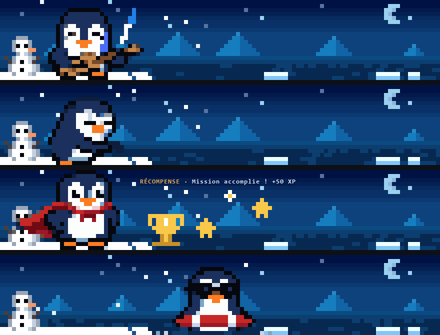

# ai-reactions · KK LAB

**Un pingouin qui vit sous ton IA.** Lance Codex, Claude Code ou Gemini CLI avec
`ai-reactions` : un petit pingouin en pixel art s’installe sur sa banquise, en
bas du terminal, sous un ciel étoilé, et réagit tout seul à ce que fait l’IA. Il
bosse avec elle, prend un café sur les longues tâches, fête la fin, se cache les
yeux quand tu l’interromps. Entre deux tâches, il vit sa vie : il joue de la
guitare, lit, peint, part nager avec sa bouée… et répond quand tu cliques dessus.
Aucun mot-clé à retenir, et rien ne vient interrompre ni recouvrir l’IA.

> **Créé par pur plaisir.** Ce projet est dédié à celles et ceux qui le
> téléchargent. Merci du fond du cœur : vous me donnez la force de continuer.
> J’espère sincèrement qu’il vous plaira.



*Le bandeau tel que le dessine le programme, à quatre moments : une occupation
(la guitare), l’IA au travail, une réaction (récompense) et une baignade.*

- **Un compagnon vivant** : 45 poses reprises pixel pour pixel de trois planches
  de dessin, des occupations qu’il choisit seul, et des réponses à tes clics,
  toujours gentilles.
- **Tout seul** : les réactions se déclenchent d’après l’écran de l’IA, sans
  mot-clé ni prompt à envoyer.
- **En bas, jamais par-dessus** : le bandeau vit sous l’IA, qui reste visible et
  utilisable pendant chaque animation. Sans fenêtre ni overlay.
- **Fluide** : 60 images par seconde, et seules les cellules qui changent sont
  envoyées au terminal.
- **12 réactions à la demande**, du `boop` sur le nez au `chill` lo-fi, chacune
  en 3 intensités, avec des **sons synthétisés à la volée** (aucun fichier audio).
- **Protocole standard** : un serveur [MCP](https://modelcontextprotocol.io) local,
  compatible avec tous les clients qui le supportent.


## Installation

Prérequis : **Node.js 24+** et une IA en ligne de commande (Codex, Claude Code ou Gemini CLI).

```sh
npm install -g --allow-scripts=node-pty https://github.com/KKanisvaran/Ai-reactions/archive/refs/heads/main.tar.gz
ai-reactions setup     # enregistre le serveur MCP dans les IA installées, puis présente les mots-clés
ai-reactions codex     # lance Codex avec le pingouin (ou : ai-reactions claude / gemini)
```

Sans npm récent, retire `--allow-scripts=node-pty`. Autre méthode : `git clone`
du dépôt puis `npm install -g --install-links ./Ai-reactions`.

Depuis les sources, sans installation globale : `npm run ai -- codex` (sous
Windows PowerShell : `npm.cmd run ai -- codex`). Le `--` transmet `codex` au
lanceur plutôt qu’à npm.

| Système | Animations | Son |
| --- | --- | --- |
| Windows 10 1809+ / 11 | Oui | Oui, via PowerShell (intégré) |
| macOS | Oui | Oui, via `afplay` (intégré) |
| Linux | Oui | Si `paplay` ou `aplay` est installé. `node-pty` se compile : `python3`, `make`, `g++` |

Désinstallation : `npm uninstall -g ai-reactions`.

## Ce qui fait réagir le pingouin

| Ce que fait l’IA | Réaction dans le bandeau |
| --- | --- |
| Elle se met au travail | Le pingouin glisse jusqu’à son ordi, puis s’y concentre, avec un coup d’œil de temps en temps |
| Elle travaille longtemps | Il réfléchit, une bulle au-dessus de la tête |
| Plus de 45 s de travail | Pause café |
| Plus de 2 min 30 | L’escargot : ça traîne |
| Elle a fini, en 15 à 40 s | EZ |
| Elle a fini, en 40 s à 2 min | Encouragement ou fusée |
| Elle a fini, après plus de 2 min | Trophée, cape de héros et XP |
| Elle attend ton feu vert (permission) | Regard suspicieux |
| Tu l’interromps | Facepalm |
| Erreur d’API | Pierre tombale |
| 5 min sans activité | Lunettes de soleil et lo-fi, puis il part pêcher et finit par s’endormir |
| Tu reviens taper | Boop, il se réveille |

Les réactions sont en pixel art, dans le décor : cœurs, tasse fumante, escargot,
palmier, trophée, fusée, pierre tombale… Seule leur légende est du texte. Les
réactions automatiques sont silencieuses.

## Le pingouin compagnon

**Quand tout est calme**, il s’occupe tout seul, jamais deux fois la même chose
de suite. Il regarde autour de lui, salue, chante, danse, jongle, grignote,
grelotte, se promène sur la banquise ou saute à l’eau avec sa bouée rouge et
blanche pour se la couler douce au large. Il a aussi ses passe-temps : lire,
festoyer, bricoler, bâtir un igloo, peindre, jouer au ninja, faire une
expérience, jouer aux jeux vidéo, offrir un cadeau, prendre une photo, observer
aux jumelles, jouer de la guitare (les notes s’envolent), avoir un coup de
cœur, avoir une idée (l’ampoule s’allume), faire le roi, jardiner ou promener
son ballon. Une mouette, un poisson qui saute ou une étoile filante passe le
voir de temps en temps.

**Clique dans le bandeau** et il te répond, toujours avec bienveillance :

| Où tu cliques | Ce qui se passe |
| --- | --- |
| Sur le pingouin | Il est content, puis salue, saute et danse : un peu plus heureux à chaque clic |
| Sur le pingouin au large | Des cœurs montent là où il flotte |
| Sur le bonhomme de neige | Le pingouin le salue |
| Sur la mer | Un poisson saute hors de l’eau |
| Dans le ciel | Une étoile filante passe |

Ses poses viennent pixel pour pixel des planches de dessin KK LAB, jamais
redessinées. La troisième planche dessine un pingouin plus long : chaque pose y
a seulement perdu ses lignes les plus redondantes, jamais le visage ni les
pieds, pour garder la même taille que les autres.

La molette de la souris fait défiler l’historique de l’IA, comme une page ;
n’importe quelle touche ramène l’écran en direct. Pour sélectionner du texte,
maintiens Maj en glissant.

Le lancement commence par l’intro KK LAB : le tigre se dessine, suivi de son
message. Puis le pingouin se dessine à son tour dans le bandeau, contour d’abord.

### Bonus : les mots-clés

Tu peux aussi demander une réaction à l’IA en tapant son mot-clé dans le chat.
L’IA appelle l’outil MCP et l’animation se joue dans le bandeau, avec son.
Demande « intensité 2 » ou « intensité 3 » pour un effet plus long et plus intense.

| Mot-clé | Effet | Son |
| --- | --- | --- |
| `boop` | Petit boop sur le nez, cœurs | « Boop » mignon |
| `café` | Pause café, réveil d’un coup | Gorgée puis arpège plein d’énergie |
| `bien joué` | Encouragement, étoiles | Arpège positif |
| `gg` | Trophée et XP | Fanfare de victoire |
| `trop long` | Escargot, sablier | Tic-tac d’horloge |
| `chill` | Lunettes de soleil, palmier | Accord lo-fi |
| `wtf` | Perplexité, points d’interrogation | « Hein ? » montant |
| `bruh` | Facepalm | Trombone triste |
| `let's go` | Fusée qui décolle | Fanfare montante |
| `rip` | Pierre tombale | Orgue mélancolique |
| `susp` | Regard suspicieux (suspense) | Deux notes graves |
| `ez` | Victoire trop facile | Petit « ding » |

`ai-reactions intro` remontre cette liste avec l’intro KK LAB.
`ai-reactions demo gg rip` joue des effets sans IA.

## Comment ce projet est né

Tout part d’un réflexe qu’on a tous en codant avec une IA : on lui parle comme à
un coéquipier. On s’impatiente quand elle tourne en rond, on la félicite quand
elle trouve enfin le bug. Mais elle ne voit rien de tout ça, et l’échange reste
un mur de texte.

En septembre 2026, j’ai voulu rendre ces moments **visibles et drôles** sans
casser le flux de travail. La première version tenait en quatre réactions,
taquineries et encouragements, jouées dans une fenêtre à part. Deux contraintes
ont façonné la suite :

1. **Rester dans le terminal de l’IA.** Le protocole MCP permet à l’IA d’appeler
   un outil, mais pas de dessiner dans sa propre interface. La solution : un
   lanceur qui héberge l’IA dans un pseudo-terminal avec un écran virtuel. Il
   peut ainsi jouer l’animation par-dessus, puis restaurer l’écran à l’identique.
2. **Ne jamais toucher à l’IA.** Pas de touches simulées, pas d’interruption de
   processus : l’IA continue de travailler pendant l’effet.

Les réactions sont ensuite devenues plus variées et plus chill (`trop long`,
`chill`, `bruh`…), puis le projet est devenu une vraie CLI installable, avec
l’identité **KK LAB** et son tigre en intro.

La version 2 retire la dernière friction : taper un mot-clé, c’est envoyer un
prompt à l’IA. Un pingouin vit désormais dans un bandeau sous l’IA, lit son
écran en mémoire et réagit tout seul, sans jamais la recouvrir.

Puis le pingouin est devenu un **compagnon** : ses poses sont reprises de trois
planches de dessin, il choisit ses occupations, répond aux clics, part nager,
et le tout tourne à 60 images par seconde.

## Comment ça marche

```text
  l’IA (Codex, Claude Code, Gemini CLI)
   │  tourne dans un pseudo-terminal du lanceur
   ▼
  lanceur ai-reactions
   │  garde une copie de l’écran de l’IA, en mémoire
   │   ├─ indices à l’écran (« esc to interrupt », permission,
   │   │  interruption, erreur) ──────────────► humeur du pingouin
   │   └─ mot-clé dans le chat : l’IA appelle l’outil MCP,
   │      le serveur ai-reactions l’écrit dans le journal local,
   │      le lanceur le lit ───────────────────► réaction et son
   ▼
  ton terminal, 60 images par seconde
  ┌──────────────────────────────────────────┐
  │ l’IA, intacte et utilisable              │
  │ …                                        │
  ├──────────────────────────────────────────┤
  │ bandeau : le pingouin dans sa nuit       │  10 lignes
  │ polaire, ses occupations et réactions    │
  └──────────────────────────────────────────┘
```

- **Serveur MCP** (`src/server.ts`, `src/reactions.ts`) : expose 12 outils sur
  stdio, valide chaque appel et écrit l’événement dans un journal local.
- **Lanceur** (`scripts/session.mjs`, `src/session-terminal.ts`, `src/mouse.ts`) :
  lance l’IA dans un pseudo-terminal `node-pty`, garde une copie de son écran
  avec `@xterm/headless` et réserve le bas du terminal au bandeau. Il ne renvoie
  que les lignes et les cellules qui changent, et gère la molette et les clics.
- **Horloge** (`src/frame-clock.ts`) : 60 images par seconde sur des échéances
  fixées d’avance (les timers de Windows n’avancent que par pas de ~15,6 ms) ;
  une image en retard est sautée, jamais rejouée en rafale, et une image est
  sautée si le terminal n’a pas fini d’afficher la précédente.
- **Bandeau** (`src/ambient.ts`, `src/companion.ts`, `src/penguin.ts`,
  `src/decor.ts`, `src/scenes.ts`) : l’humeur du pingouin, déduite de l’écran
  virtuel en mémoire uniquement ; ses occupations et ses réponses aux clics ;
  ses 45 poses ; sa nuit polaire (ciel en dégradé, étoiles qui scintillent,
  lune, montagnes, mer qui miroite, banquise, bonhomme de neige, petite neige) ;
  et les réactions en pixel art.
- **Son et repli** (`src/sound.ts`, `src/terminal-animation.ts`) : sons WAV
  synthétisés mathématiquement ; dans un terminal trop petit pour le bandeau,
  une réaction MCP s’affiche en plein écran le temps de l’effet.
- **Intro** (`src/intro.ts`, `src/mascot-render.ts`, `src/mascot-image.ts`) : à
  chaque lancement, la mascotte KK LAB se dessine au centre d’après son SVG, avec
  son message en dessous ; au premier lancement, la liste des mots-clés suit.
  Dans un terminal compatible Sixel (Windows Terminal 1.22+, WezTerm, iTerm2),
  l’image elle-même remplace le dessin ; ailleurs, dont le terminal de VS Code
  sous Windows, le tigre reste en demi-blocs Unicode truecolor.

## Commandes

| Commande | Rôle |
| --- | --- |
| `ai-reactions setup [codex\|claude\|gemini]` | Enregistre le serveur MCP (tous les clients installés par défaut) |
| `ai-reactions codex [args]` | Lance l’IA avec le pingouin, aussi `claude` et `gemini` |
| `ai-reactions intro` | Intro KK LAB et liste des mots-clés |
| `ai-reactions demo [mots-clés]` | Joue des effets sans IA |
| `ai-reactions watch` | Visualiseur séparé, dans un autre volet de terminal |
| `ai-reactions serve` | Serveur MCP sur stdio, pour une configuration manuelle |

Configuration manuelle d’un client MCP : commande `node`, argument
`<dossier d’installation>/dist/index.js`. Voir les exemples dans [`examples/`](examples/).

## Réglages

| Variable | Défaut | Effet |
| --- | --- | --- |
| `AI_REACTIONS_SOUND` | `1` | `0` coupe le son |
| `AI_REACTIONS_VOLUME` | `0.3` | Volume de 0 à 1 |
| `AI_REACTIONS_INTRO` | `1` | `0` désactive l’intro du lancement |
| `AI_REACTIONS_AMBIENT` | `1` | `0` retire le pingouin sous l’IA |
| `AI_REACTIONS_EFFECTS` | `terminal` | `text` : journal et messages seuls |
| `AI_REACTIONS_LOG` | `~/.ai-reactions/reactions.jsonl` | Chemin absolu du journal |

Le bandeau fait toujours 10 lignes : comme une image sur une page web, le
pingouin garde sa taille et seul le décor suit la largeur du terminal (le
bonhomme de neige apparaît à partir de 100 colonnes, les scènes sont coupées au
bord quand la place manque). Il demande au moins 40 × 18 caractères. En dessous,
l’IA garde tout l’écran et une réaction MCP s’affiche en plein écran le temps de
l’effet (61 × 16 minimum). L’intro s’adapte au terminal : 30 × 13 au minimum,
54 × 22 pour la liste des mots-clés. Si la sortie est capturée, une image fixe
est affichée.

## Sécurité et vie privée

- Tout reste **local** : aucun port ouvert, aucune requête réseau, aucune télémétrie.
- Le journal ne contient que les réactions, jamais tes conversations.
- Le bandeau lit le bas de l’écran de l’IA, en mémoire, pour y repérer quelques
  indices génériques (« esc to interrupt », une demande de permission, une
  erreur d’API). Il n’en garde que des oui/non : jamais le texte, ni ton code, ni
  tes questions. Rien n’est enregistré ni envoyé. `AI_REACTIONS_AMBIENT=0` le coupe.
- Les entrées MCP sont validées strictement. Le journal rejette les caractères
  de contrôle, pour qu’aucune séquence ne puisse piloter ton terminal.
- Aucune touche n’est simulée et aucun processus n’est interrompu.

Pour signaler une faille, voir [SECURITY.md](SECURITY.md).

## Développement

```sh
git clone https://github.com/KKanisvaran/Ai-reactions.git && cd Ai-reactions
npm ci
npm test               # build + 45 tests : MCP, bandeau, pingouin, rendu, sons, journal, pseudo-terminal réel
npm run demo
npm run ai -- codex    # lanceur depuis les sources (Windows PowerShell : npm.cmd run ai -- codex)
```

`dist/` est versionné pour que l’installation n’ait rien à compiler. Après une
modification de `src/`, lance `npm run build` et commite `dist/` avec. La CI le
vérifie sur Windows, Linux et macOS.

Pour ajouter une réaction : sa définition (mot-clé, résumé, messages) dans
`src/reactions.ts`, sa scène en pixel art dans `src/scenes.ts`, la pose du
pingouin dans `penguinFrame` (`src/ambient.ts`), son son dans `src/sound.ts` et
son repli plein écran dans `src/terminal-animation.ts`.

## Licence

Code sous licence **MIT**, voir [LICENSE](LICENSE).

**Exception** : le nom et le logo **KK LAB**, la mascotte tigre (son image dans
`src/mascot-image.ts` et l’intro), le pingouin (ses poses dans `src/penguin.ts`)
et les planches de dessin (`assets/`) restent © KKanisvaran, **tous droits
réservés**. Un fork peut reprendre le code, mais doit remplacer ces éléments.

---

Un projet **KK LAB**, par [KKanisvaran](https://github.com/KKanisvaran).
